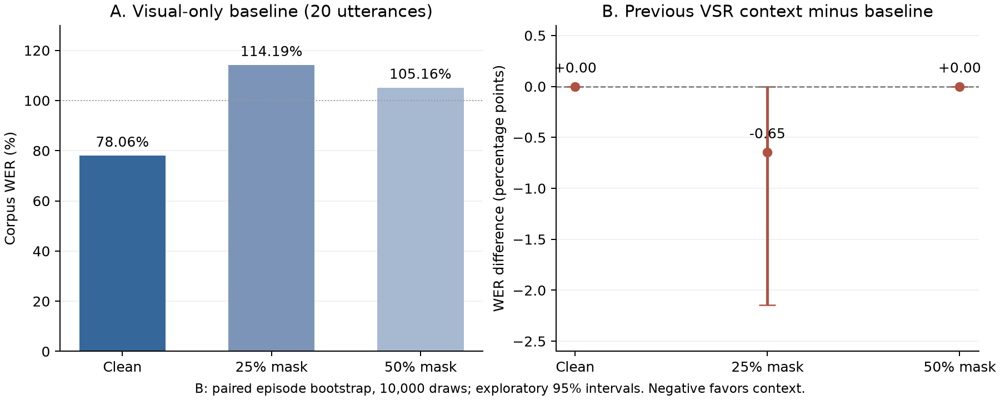

# 입술 가림 환경에서 대화·장면 문맥을 이용한 시각 음성 인식 보정
## MELD 기반 대조 실험과 성능 한계 분석

**2026 공과대학 학술제 연구보고서 · 실험 및 분석 마감: 2026년 10월 17일**

> 본 보고서는 실제 실행한 영어 VSR 실험의 결과를 정리한다. 주 실험과 개발용 대조 실험, 최종 불확실성 분석을 완료했다. 문맥 기반 자막 성능 향상이나 실사용 시스템 완성을 입증한 보고서는 아니다.
>
> 기존 한국어 예비실험과 32단계 개발 기록은 [연구 일지 보관본](docs/archive/2026-10-17/README.md)으로 분리했다. [수정하지 않은 원문](docs/archive/2026-10-17/README.original.md)과 [보존 해시](docs/archive/2026-10-17/manifest.json)도 함께 보관한다.

## 초록

본 연구는 입술 정보가 가려진 영상에서 이전 대화와 장면 문맥이 시각 음성 인식(Visual Speech Recognition, VSR) 자막을 개선할 수 있는지 검토하였다. 영어 사전학습 AutoAVSR을 고정하고 MELD의 현재·이전 발화 쌍을 이용하였다. 개발용 5발화와 분리한 20쌍에서 입 영역의 clean·25%·50% 가림을 비교하고, 문맥 없음·실제 이전 VSR·장면·대화와 장면의 결합·다른 대화·이전 정답 전사의 일곱 조건을 평가하였다. 현재 발화 정답은 모든 생성이 끝난 뒤 채점에 사용하였다.

원시 VSR의 단어 오류율(WER)은 clean 78.06%, 25% 가림 114.19%, 50% 가림 105.16%였다. 실제 이전 대화를 사용한 보정은 25% 가림에서 WER를 113.55%로 낮췄지만, 다른 대화도 같은 감소를 보였다. 이 차이 −0.65%p의 탐색적 95% 부트스트랩 구간은 −2.14~0.00%p였으며, 완전한 문장 복구는 없었다. 장면 문맥의 추가 WER 이득도 관찰되지 않았다. 편집 한도는 큰 오수정을 억제했지만 개선 후보도 차단하였다. 추가 대조 실험에서는 장면 캡션의 완결성만 개선됐고, 단어 편집 인터페이스·상위 VSR 후보 선택·입 좌표 평활화는 일관된 자막 개선으로 이어지지 않았다. 결과는 현재 구성의 한계를 보여 주며, 향후 문맥 보정에 앞서 실제 입 영상과 VSR 후보의 품질을 확보해야 함을 시사한다.

**핵심어:** 시각 음성 인식, 립리딩, 입술 가림, 대화 문맥, 장면 문맥, 오류 보정

## 1. 연구 배경과 목적

영상에서 입술 움직임만으로 발화를 인식할 때 입의 가림, 측면 촬영, 잘못된 입 영역 추적은 관측 정보를 줄일 수 있다. 이전 발화나 주변 장면은 불확실한 단어를 판단하는 보조 정보가 될 수 있지만, 잘못된 문맥을 따라 자막을 바꾸는 위험도 있다. 본 연구는 이러한 기대와 위험을 같은 표본에서 비교하였다.

VSR 기반 모델로 AutoAVSR의 공개 시각 입력 모델을 사용하였다. AutoAVSR은 자동 생성한 전사를 활용한 음성·시각 음성 인식 학습을 제안한 연구이다. 본 연구의 점수는 해당 논문의 벤치마크 성능을 재현한 결과가 아니다. [Ma et al. (2023)](https://arxiv.org/abs/2303.14307)

MELD는 원래 대화의 감정 인식을 위해 구성된 멀티모달 자료로, 방송 대화의 영상과 전사를 제공한다. 본 연구에서는 발화 간 연결을 이용하기 위해 선택했으며, 감정 인식을 수행하거나 MELD를 전용 립리딩 벤치마크로 간주하지 않았다. [Poria et al. (2019)](https://aclanthology.org/P19-1050/)

초기 한국어 VSR 실험은 예비연구로 보존하고, 본 보고서의 주 분석은 영어 VSR과 MELD로 한정하였다. 연구 질문은 다음과 같다.

1. 동일 발화에서 입술 가림은 원시 VSR 오류율을 얼마나 변화시키는가?
2. 실제 이전 대화는 문맥 없는 보정 및 엉뚱한 대화보다 유리한가?
3. 얼굴을 가린 장면 문맥을 추가하면 자막이 더 좋아지는가?
4. 편집 제한과 대체 보정 방식은 오류 복구와 손상에 어떤 영향을 주는가?

## 2. 연구 방법

### 2.1 자료 구성과 실험 분리

| 구분 | 구성 | 목적 |
|---|---|---|
| 개발 자료 | MELD train의 기존 3개 대화, 현재 발화 5개 | 프롬프트·보정·장면·전처리 진단 |
| 평가 후보 | 개발 에피소드를 제외한 30개 현재·이전 발화 쌍, 영상 60개 | 결과를 보기 전 영상·화자 ROI·장면 마스킹 검토 |
| 주 평가 | 사전 기준을 통과한 20쌍, 서로 다른 20개 대화 및 20개 에피소드 | 고정된 조건 비교 |

주 평가 표본은 이전·현재 발화 모두 입 좌표 관측 10프레임 이상·관측률 25% 이상을 충족하고, 목표 화자 입 crop 및 장면 얼굴 마스킹 검토를 통과한 앞 20쌍으로 확정했다. 10개 제외 후보의 사유도 보존했다. 점수가 나쁘다는 이유로 표본을 교체하지 않았다. 이 표본은 **MELD train 내부에서 프로젝트 개발 자료와 분리한 평가 집합**이며 공식 test split이 아니다.

현재 발화 20개는 정규화 후 총 155단어, 공백 제외 644문자다. 같은 발화의 세 가림 조건은 반복 측정이므로 독립 표본 60개로 계산하지 않는다. 주 실험의 전체 420행 역시 420개의 독립 발화가 아니다.

선정 근거: [후보와 제외 사유](experiments/meld_heldout_screening_2026-10-03.json), [확정 표본과 문맥 매핑](experiments/meld_heldout_final_plan_2026-10-03.json).

### 2.2 입력 처리와 가림

MediaPipe 검출과 수동 시각 앵커로 목표 화자의 입 영역을 연결하였다. 공식 정렬 방식으로 96×96 입 crop을 만든 뒤 중앙 88×88 영역을 사용했다. RGB를 흑백으로 변환하고 평균 0.421, 표준편차 0.165로 정규화했다. 약 23.976fps의 원본은 기존 floor 매핑으로 25fps 입력을 구성했으며, 입을 관측하지 못한 프레임은 시간축을 유지한 채 정규화 값 0으로 채웠다.

주 실험의 입 좌표 정렬은 프레임별로 수행하였다. 입술 가림은 88×88 입력 중앙에 높이 22픽셀 또는 44픽셀의 가로띠를 모든 프레임에 적용했다. 가림 값은 정규화 값 0이다. 따라서 **본 실험은 정해진 형태의 합성 가림**이며 실제 마스크·손·물체의 모든 가림 상황을 대표하지 않는다.

### 2.3 모델과 보정 조건

| 구성 | 고정 설정 |
|---|---|
| VSR | AutoAVSR visual-only checkpoint, beam 40, CTC 0.1·attention 0.9·외부 LM 0 |
| 장면 추출 | SmolVLM2-2.2B-Instruct Q4_K_M, 얼굴을 가린 중앙 시점 이미지 1장, 캡션 최대 96토큰 |
| 장면 구조화 | Qwen2.5-1.5B-Instruct Q4_K_M, 최대 192토큰 |
| 자막 보정 | 같은 Qwen 모델, temperature 0, seed 2026, 최대 128토큰 |
| 편집 검사 | 원시 VSR 대비 정규화한 한 단어 삽입·삭제·치환 이내만 수락 |
| 실행 | 로컬 CPU, 모델 추론 스레드 2, 동일 체크포인트·처리 코드 유지 |

장면에는 얼굴·입 모양을 직접 제공하지 않았으며 `scene/objects/actions/emotion/speaker_tracking_cue` 구조를 사용했다. 감정은 항상 null로 두었다. 원문 캡션의 일부 성별·발화·감정 추정 표현은 중립화와 고정 어휘 필터로 제거했지만, 이것이 의미적 정확성을 보장하지는 않는다. 사용 모델은 [SmolVLM2 GGUF](https://huggingface.co/ggml-org/SmolVLM2-2.2B-Instruct-GGUF)와 [Qwen2.5 GGUF](https://huggingface.co/Qwen/Qwen2.5-1.5B-Instruct-GGUF)이다. 실제 revision·가중치 SHA-256·프롬프트는 [실험 provenance](experiments/meld_heldout_provenance_2026-10-04.json)에 기록했다.

| 조건 | 보정기에 제공한 보조 정보 | 역할 |
|---|---|---|
| C0 | 보정 없음 | 원시 VSR 기준 |
| C0_LLM | 없음 | 언어 모델 자체의 수정 효과 |
| C1 | 같은 대화의 실제 이전 VSR 출력 | 실용적인 대화 문맥 |
| C2 | 얼굴을 가린 장면 정보 | 장면 문맥 |
| C3 | 실제 이전 VSR + 장면 | 결합 문맥 |
| C4 | 사전에 매핑한 다른 대화의 이전 VSR | 잘못된 문맥 대조 |
| C5 | 같은 대화의 이전 발화 정답 전사 | 진단용 oracle; 실용 조건과 분리 |

보정기는 현재 VSR을 주된 근거로 삼고 문맥을 복사하거나 대답하지 않도록 지시했다. 한 단어보다 많이 바꾼 후보나 생성 실패는 원시 VSR로 되돌렸다. 편집 한도는 정답을 보지 않는 기계적 제한으로, 수정의 정확도나 신뢰도를 뜻하지 않는다.

### 2.4 정답 분리와 실패 처리

모든 20×3×7 출력 조합이 완료됐는지 확인한 뒤 현재 정답을 평가용으로 추출했다. C5의 이전 정답 파일은 현재 목표 ID와 분리했다. 원본 CSV는 앞선 메타데이터·이전 전사 추출에도 읽었으므로, CSV 파일 자체를 그때 처음 열었다는 뜻은 아니다.

주 실험에서 VSR 80회(이전 clean 20 + 현재 60), 보정 360회를 완료했으며 실행 실패는 각각 0회였다. 장면 캡션 20개 중 9개는 완결됐고 11개는 길이 제한으로 종료됐다. 성공 캡션의 구조화 9회도 완료했다. 장면 실패 11개는 visual=null로 전 조건에 유지했다. 실행 중단 때 이미 저장된 성공·실패 14개는 재사용하고, 미저장 요청만 같은 설정으로 재개했다.

## 3. 평가 지표와 최종 분석

WER는 정답 단어 수를 분모로 한 삽입·삭제·치환 거리의 합, CER는 공백을 제외한 문자 거리의 합이다. 문장별 오류율의 단순 평균이 아니라 **corpus 오류율**을 사용했다. 영어는 소문자화하고 아포스트로피를 통일하며 나머지 문장부호를 공백으로 바꿨다. 삽입 때문에 WER는 100%를 넘을 수 있다.

- **개선/동일/악화:** 원시 VSR보다 문장별 단어 오류 수가 감소/유지/증가한 수.
- **완전 복구율:** 원래 오답인 문장 중 단어 오류가 0이 된 비율.
- **정답 손상률:** 원래 완전 정답인 문장 중 오류가 생긴 비율. 분모가 0이면 산출 불가다.
- **변경률:** 정규화한 자막 단어열이 실제로 바뀐 비율. 변경과 개선은 구분한다.

보고서 마감 단계에서는 새 모델 호출 없이 고정된 결과에 **짝지은 에피소드 부트스트랩**을 추가했다. season+episode를 재표집 단위로 하여 조건 간 대응을 유지하고, 10,000회·seed 20261017·2.5/97.5 백분위 구간을 계산했다. 이번 표본은 에피소드마다 1개여서 20개의 재표집 단위다. 결과는 사후 탐색적 구간이며 다중비교 보정된 확증 검정이 아니다. 관측 오류가 같아서 구간이 [0, 0]인 경우도 모집단 동등성을 입증하지 않는다.

장면 완결 성공 9개와 실패 11개를 나눈 분석은 실패의 영향을 살펴보는 사후 민감도 분석이다. 유리한 일부를 주 성능으로 바꾸지 않았다. [최종 분석 수치와 재현 설정](experiments/report_final_analysis_2026-10-17.json)

## 4. 주 실험 결과

### 4.1 조건별 WER·CER

**표 1. 고정 평가 20쌍의 WER / CER(%). 낮을수록 좋다.**

| 조건 | clean | 25% 가림 | 50% 가림 |
|---|---:|---:|---:|
| C0 원시 VSR | 78.06 / 60.56 | 114.19 / 87.73 | 105.16 / 84.01 |
| C0_LLM 문맥 없음 | 78.71 / 61.18 | 114.19 / 88.35 | 105.16 / 84.01 |
| C1 실제 이전 VSR | 78.06 / 60.56 | 113.55 / 87.42 | 105.16 / 84.47 |
| C2 장면 | 78.71 / 61.18 | 114.19 / 88.35 | 105.16 / 84.94 |
| C3 대화 + 장면 | 78.06 / 60.56 | 113.55 / 87.42 | 105.16 / 84.94 |
| C4 다른 대화 VSR | 78.71 / 61.18 | 113.55 / 87.42 | 105.16 / 84.01 |
| C5 이전 정답 oracle | 78.71 / 61.18 | 113.55 / 87.42 | 105.16 / 84.47 |



**그림 1.** 왼쪽은 원시 VSR WER, 오른쪽은 C1−C0의 WER 차이와 탐색적 95% 구간이다. 음수는 문맥 조건에 유리하다. [벡터 그림](docs/figures/report_main_results.svg)

원시 VSR은 clean보다 25% 가림에서 **+36.13%p**(구간 16.13~57.07), 50% 가림에서 **+27.10%p**(11.80~41.71) 악화했다. 두 가림 사이에는 단조 관계가 없었다. 50% 가림의 WER가 더 낮다는 사실을 일반적인 경향으로 확대하지 않는다.

실제 이전 대화 C1의 25% 가림 개선은 **−0.65%p**(−2.14~0.00)로, 단어 오류 1개 감소에 해당했다. C4와 C5도 같은 개선을 보였다. C1과 C3의 WER는 모든 가림에서 같았고, 50%의 CER는 C3가 더 나빴다. 따라서 이 실험에서 올바른 대화나 장면을 활용한 뚜렷한 이득을 확인하지 못했다.

### 4.2 문장별 개선·손상

**표 2. 원시 VSR 대비 개선 / 동일 / 악화 문장 수. 각 칸의 합은 20이다.**

| 조건 | clean | 25% 가림 | 50% 가림 |
|---|---:|---:|---:|
| C0_LLM | 0 / 19 / 1 | 0 / 20 / 0 | 0 / 20 / 0 |
| C1 | 0 / 20 / 0 | 1 / 19 / 0 | 0 / 20 / 0 |
| C2 | 0 / 19 / 1 | 0 / 20 / 0 | 0 / 20 / 0 |
| C3 | 0 / 20 / 0 | 1 / 19 / 0 | 0 / 20 / 0 |
| C4 | 0 / 19 / 1 | 1 / 19 / 0 | 0 / 20 / 0 |
| C5 | 0 / 19 / 1 | 1 / 19 / 0 | 0 / 20 / 0 |

모든 보정 조건의 완전 복구율은 0%였다. 분모는 clean 20, 25% 19, 50% 20문장이다. 원래 정답 문장은 25% 가림에서만 1개였고 모든 조건의 손상은 0/1이었다. clean과 50%의 정답 손상률은 **0/0으로 산출 불가**이므로 안전하다는 근거로 사용할 수 없다.

보정 호출 360회 중 변경 제안은 52건, 수락은 14건(전체의 3.89%), 거절은 38건이었다. 건수는 발화×가림×보정 조건 단위이며 서로 다른 52문장이라는 뜻이 아니다. 거절 후보 중 20건은 단어 오류를 늘리고 9건은 줄이며 9건은 유지했다. clean C1/C3의 한도 적용 전 후보 WER는 105.81%였고, 한도 적용 후에는 78.06%였다. 한도는 큰 손상을 막았지만 개선 후보도 차단했다.

### 4.3 장면 실패를 분리한 분석

장면 추출은 9/20만 완결됐으므로 전체 결과에는 문맥이 없는 사례가 많이 포함돼 있다. 성공 9개만 비교해도 C0/C1/C2/C3의 WER는 각각 clean **71.43%**, 25% **102.86%**, 50% **104.29%**로 조건 간 같았다. 따라서 이번 표본에서 장면 이득이 없었던 현상을 실패 11개만으로 설명할 수는 없다. 다만 완결된 장면 내용의 정확성이 검증됐다는 의미도 아니다.

### 4.4 대표 사례

| 사례 | 실제 관찰 | 해석 |
|---|---|---|
| `dia22_utt1`, 25% | C1/C3/C4/C5 모두 첫 단어 삭제로 오류 10→9 | 여전히 정답 9단어 대비 오류 9개. 의미 복구나 올바른 문맥의 우위가 아님 |
| `dia7_utt1`, clean | C0_LLM/C2/C4/C5의 반복 단어 삭제로 오류 3→4 | 한 단어 수정도 해로울 수 있음. 문맥 없는 조건도 같아 다른 대화만의 원인으로 단정 불가 |
| `dia35_utt1`, 50% | C2/C3의 한 단어 추가로 단어 오류 3→3, 문자 오류 +6 | WER만 같아도 내용은 더 나빠질 수 있음 |
| `dia8_utt2`, clean | C1/C3의 큰 편집 후보가 오류 4→28, 최종 거절 | 문맥을 따른 과도한 재작성의 위험과 편집 한도의 보호 효과 |

이 사례들은 연관 관찰이며 개별 장면 필드의 인과 효과를 분리한 실험은 아니다. [전체 사례 수치](experiments/meld_heldout_analysis_2026-10-04.json)

## 5. 개발용 대조 실험과 실패 원인 진단

주 평가 뒤의 대안 실험은 기존 개발용 5발화에서 수행했다. 새로운 설정으로 20쌍의 성능을 다시 골라 보고하지 않았다.

**표 3. 추가 실험의 실행 범위와 결과.**

| 실험 | 실제 실행 | 결과 및 판단 |
|---|---|---|
| 캡션 한도 96→192 | 같은 이미지 5회 + 구조화 5회 | 완결 4/5→5/5. 기존 성공 4개 원문은 동일. 잘못된 장면·행동 묘사는 남았으며 자막 이득은 별도 검증하지 않음 |
| 위치 지정 한 단어 편집 | 90회 | 삭제 필드 규칙을 90/90 위반해 원문 유지. 통신 실패가 아닌 편집 인터페이스 실패 |
| VSR 상위 5개 후보 선택 | VSR 15회 + 선택 90회 | 15/15에서 기존 1순위 재현. 선택은 오류 없이 완료했지만 90/90 모두 1순위라 실제 개선 없음 |
| 입 좌표 평활화 | VSR 15회 | 기존 입력 5/5 정확 재현 후 평활화만 변경. clean WER 75.00→89.29%, 25% 114.29→110.71%, 50% 117.86→117.86%. 원래 맞던 문장 손상으로 채택하지 않음 |

후보 선택 실험에서는 정답을 이용해 사후에 가장 좋은 후보를 고른다고 가정해도, 개발 자료의 WER가 clean **64.29%**, 25% 및 50% 가림 **103.57%**였다. 가림 조건의 후보 목록에는 완전한 정답이 0/5개였으며, 이는 실제 선택기의 성능이 아닌 **후보 집합의 한계**다.

주 평가 20쌍에서도 한 문장당 한 단어만 고칠 수 있는 이상적 정답 인지 보정기의 최저 WER는 clean 65.16%, 25% 101.94%, 50% 92.26%였다. 실제 모델이 달성한 값이 아니며, 크게 틀린 VSR을 한 단어 보정만으로 복구하기 어렵다는 수학적 진단이다.

입 영상 검토에서는 관측이 11/35프레임인 발화뿐 아니라 43/43프레임에서 검출됐는데도 오류가 많은 발화도 있었다. **검출 성공을 유효한 입 영상의 품질과 동일시할 수 없다.** 이 결과만으로 입 노출, 촬영 각도, 영역 추적 중 어느 요인이 원인인지 확정하지는 않는다.

근거: [대안 실험](experiments/development_diagnostics_2026-10-09.json), [후보 oracle](experiments/development_rerank_oracle_2026-10-09.json), [평활화](experiments/meld_smoothing_2026-10-10.json), [한 단어 한계](experiments/heldout_one_edit_bound_2026-10-09.json).

## 6. 논의와 한계

첫째, 이번 자료에서는 합성 가림이 원시 VSR 성능을 악화시켰지만 문맥 보정은 이를 충분히 복구하지 못했다. 실제 이전 대화의 작은 변화가 잘못된 대화에서도 나타났고, 문맥 없는 언어 모델과 같은 악화 사례도 있었다. 관찰된 변화를 문맥 이해의 성과로 해석하기 어렵다.

둘째, 실패는 한 단계에만 있지 않았다. VSR 후보 자체에 정답이 없는 경우, 장면 모델이 사실과 다른 내용을 생성하는 경우, 보정기가 입력 계약을 따르지 못하는 경우, 후보 선택이 원문 유지에 머무르는 경우를 구분했다. 편집 제한은 보수적인 방어 수단이지만 정답에 대한 신뢰도를 제공하지 않는다.

셋째, 표본은 시각 QA를 통과한 작은 집합이다. 공식 test가 아니며 같은 방송의 영상이므로 출처 편향, 에피소드 간 의존성, 모델 사전학습 자료와의 중복을 배제하지 못했다. 주 실험은 하나의 가중치·seed·가림 형태에 한정된다. 장면 필드별 제거 실험과 더 큰 모델 비교도 수행하지 않았다.

넷째, 정답을 본 뒤 수행한 개발 진단과 부트스트랩·부분집합 분석은 탐색적 결과다. 좁은 구간이나 변화 없음이 일반적인 동등성·안전성을 입증하지 않는다. 사람의 주관적 자막 이해도와 의미 보존, 실시간 지연, 실제 물체 가림에서의 사용성도 평가하지 않았다.

## 7. 결론

본 연구는 고정된 VSR과 동일 발화의 가림·문맥 대조 조건을 구현하고, 오류율뿐 아니라 수정·복구·손상을 함께 평가하였다. 평가 20쌍에서 입술 가림에 따른 오류 증가는 관찰됐으나 **현재 구성의 실제 이전 대화 또는 장면 문맥이 자막을 안정적으로 개선한다는 근거는 확보하지 못했다.** 일부 수정은 원래 정보를 손상시켰고, 편집 제한은 손상과 함께 개선도 막았다.

따라서 본 연구의 결과는 성능 향상 시스템의 완성보다, 문맥 보정의 실패 조건과 입력·후보 품질의 한계를 정량적으로 확인한 데 있다. 후속 연구에서는 정답 전사와 독립적으로 입 노출·목표 화자 유지·촬영 각도를 먼저 검증하고, 충분한 후보 품질을 확보한 뒤 더 넓고 독립적인 평가 자료에서 문맥의 추가 이득을 검토해야 한다.

**보고서 범위의 실험·분석은 완료했다.** 위 후속 과제는 미완료 결과를 완료로 표시한 것이 아니라, 이번 결론을 확장하기 위한 별도 연구다.

## 8. 재현과 자료 보존

공개 저장소에는 실험 코드, 고정 계획, ID별 오류 수, 모델·입력·출력 해시를 보관한다. 영상·전체 자막·가중치·원시 생성 응답은 로컬의 Git 제외 폴더에 보존했다. 따라서 공개 JSON만으로 보고서 수치는 재집계할 수 있지만 모델 추론 전체 재현에는 같은 원본 자료·가중치·환경이 필요하다.

| 자료 | 위치 |
|---|---|
| 주 실험 전체 점수·조건 | [평가 JSON](experiments/meld_heldout_evaluation_2026-10-04.json) |
| 설정·가중치 해시·완료·정답 접근 기록 | [provenance](experiments/meld_heldout_provenance_2026-10-04.json) |
| 최종 불확실성·부분집합 분석 | [최종 분석 JSON](experiments/report_final_analysis_2026-10-17.json) |
| 평가 입력·참조 분리 코드 | [held-out 평가](kvsr/meld_heldout_evaluation.py) |
| 최종 분석·그림 코드 | [분석](kvsr/report_analysis.py), [그림](kvsr/report_figure.py) |
| 이전 전체 연구 기록 | [보관본](docs/archive/2026-10-17/README.md) |
| 최초 연구 계획 | [연구 계획](docs/RESEARCH_PLAN.md) |

로컬 최종 확인에서 **113개 테스트가 통과**했다. 주 실험 420행의 누락·중복, 원본 출력 해시, 지표 분모 및 대응 표본을 검증했다. 보고서 마감일에 새 모델 추론을 실행한 것으로 계산하지 않았으며, 기존 생성 결과에 대한 최종 분석과 검증을 추가했다.

```powershell
# 공개 점수 + 기존 로컬 출력 해시 검증을 포함한 최종 분석 재실행
# 새 파일명을 지정해 마감 결과를 덮어쓰지 않는다.
.venv/Scripts/python.exe -m kvsr.report_analysis --output results/report_analysis_recheck.json

# 공개 수치에서 보고서 그림 재생성
.venv_english/Scripts/python.exe -m kvsr.report_figure

# 자동 테스트: 임시 폴더는 쓰기 가능한 작업공간 내부로 지정
New-Item -ItemType Directory -Force results/test_tmp | Out-Null
.venv/Scripts/python.exe -c "import tempfile, unittest; from pathlib import Path; tempfile.tempdir=str(Path('results/test_tmp').resolve()); r=unittest.TextTestRunner().run(unittest.defaultTestLoader.discover('tests')); raise SystemExit(not r.wasSuccessful())"
```

## 참고문헌

1. Poria, S., Hazarika, D., Majumder, N., Naik, G., Cambria, E., & Mihalcea, R. (2019). [MELD: A Multimodal Multi-Party Dataset for Emotion Recognition in Conversations](https://aclanthology.org/P19-1050/). *ACL*, 527–536.
2. Ma, P., Haliassos, A., Fernandez-Lopez, A., Chen, H., Petridis, S., & Pantic, M. (2023). [Auto-AVSR: Audio-Visual Speech Recognition with Automatic Labels](https://arxiv.org/abs/2303.14307). arXiv:2303.14307.
3. ggml-org. [SmolVLM2-2.2B-Instruct-GGUF 모델 저장소](https://huggingface.co/ggml-org/SmolVLM2-2.2B-Instruct-GGUF). 사용 revision은 실험 provenance 참조.
4. Qwen. [Qwen2.5-1.5B-Instruct-GGUF 모델 저장소](https://huggingface.co/Qwen/Qwen2.5-1.5B-Instruct-GGUF). 사용 revision은 실험 provenance 참조.
